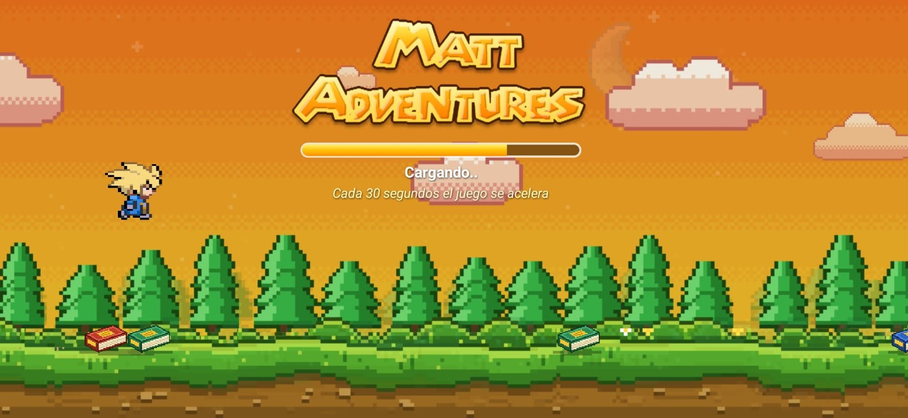

# Matt Adventures

An educational math game for Android. Matt runs automatically through a pixel-art world, and the player taps the screen to jump over the books in his way. Hitting one pauses the game and asks a math question with three options: a correct answer lets Matt continue, and a wrong one costs a heart.

The game and its questions are in Spanish. It has no external dependencies and requests no permissions.

Created by [CrisGP14](https://github.com/CrisGP14).

## Screenshots

| Main menu | Splash screen (game in demo mode) |
|---|---|
|  |  |

## Gameplay

- **One-tap control:** Matt runs on his own; tap to jump.
- **Obstacles:** single books, pairs, and towers of 4 or 6 books, placed at random with gaps that can always be cleared.
- **Speed:** increases at 30, 60 and 90 seconds. The first two increases also change the scenery and music, from day to sunset and then night.
- **Questions:** 30 math questions that do not repeat until all have been used. Each has an optional hint that costs 15 points.
- **Lives:** four hearts. A correct answer gives 1.8 seconds of invulnerability; losing every heart ends the run.
- **Score:** meters run, plus 10 points for each obstacle cleared.
- **Records:** best score, best streak of cleared obstacles, and total correct answers.

## Tech stack

| Area | Technology |
|---|---|
| Language | Java |
| Platform | Android 5.0+ (`minSdk 21`, `targetSdk` and `compileSdk 36`), landscape only |
| Build | Gradle 8.13, Android Gradle Plugin 8.13.0, JDK 17+ |
| Graphics | Custom `View` with `Canvas`, and `BitmapShader` for the scenery layers |
| Audio | `MediaPlayer` for music and `SoundPool` for sound effects |
| Storage | SQLite for questions and player records |
| Art and audio tools | Python (Pillow, NumPy, SciPy) and ffmpeg |
| Tests | Plain Java simulations that run without Android |

## Build and run

1. Open the project folder in Android Studio (**File > Open**) and wait for the Gradle sync.
2. Press **Run** to launch it on a device or emulator, or build the APK from a terminal:

   ```bash
   ./gradlew assembleDebug        # Windows: gradlew.bat assembleDebug
   ```

   The APK is written to `app/build/outputs/apk/debug/`.

## Tests

```bash
sh correr_pruebas.sh
```

This needs only a JDK. The tests simulate the game engine (speed increases, gaps, lives, and whether every obstacle can be cleared at every speed), the question system and the splash demo.

## Architecture

The code is in `app/src/main/java/crisgp/mattadventures/` (the module `namespace`). The installed app ID is `io.github.crisgp14.mattadventures`.

| Class | Responsibility |
|---|---|
| `MotorJuego` | Pure game logic: physics, obstacles, lives and score. Independent of Android; runs at a fixed 1/120 s step using dp and seconds |
| `JuegoView` | Draws the game, handles touch input and provides the demo mode |
| `Escenario` | Parallax scenery with day, sunset and night versions |
| `Tablero` | Game screen: questions, pause, game over, sounds and saving records |
| `BolsaPreguntas`, `PreguntaJuego` | Question selection without repeats, and answer options |
| `Bdpreguntas`, `BdUsuarios`, `EPreguntas` | SQLite access for questions, player and records |
| `MainActivity` | Splash screen, with the game running in demo mode |
| `Menu`, `CargarDatos`, `ComoJugar`, `Credito`, `FondoMenuView` | Main menu, data loading, instructions and credits |
| `BaseActivity` | Full screen, back button, screen measurements and music |

### Adjusting the difficulty

Every difficulty setting is in the **AJUSTES** section of `MotorJuego`:

| Constants | Effect |
|---|---|
| `VELOCIDADES`, `SEGUNDOS_POR_NIVEL` | Speeds and how often they increase |
| `VELOCIDAD_SALTO`, `GRAVEDAD` | Jump strength and gravity |
| `GAP_*` | Space between obstacles |
| `TIPOS`, `PESOS` | Obstacle types and their probability |
| `VIDAS_INICIALES`, `SEGUNDOS_INVULNERABLE` | Lives and invulnerability time |
| `PUNTOS_POR_ESQUIVE`, `COSTO_PISTA` | Scoring and hint cost |

## Project structure

```text
app/                      Android module
  src/main/java/          game classes
  src/main/res/           layouts, images, audio, icons and values
herramientas/             Python scripts that generate the art and music
  fuentes/                source image for the logo
docs/capturas/            screenshots
pruebas/                  simulation tests (plain Java)
correr_pruebas.sh         compiles and runs the tests
```

## Art and music

The scenery is pixel art (1 art pixel = 1 dp), and the music is original chiptune synthesized in code from square and triangle waves and noise. To regenerate the assets:

```bash
pip install pillow numpy scipy    # the music also needs ffmpeg with libvorbis
```

| Script in `herramientas/` | Generates |
|---|---|
| `gen_pixel.py` | Sky, moon, clouds, trees, bushes, books and hearts |
| `gen_piso.py` | Grass and dirt, in three palettes |
| `gen_logo.py` | Game logo |
| `gen_icono.py` | Adaptive and classic launcher icons |
| `gen_musica.py` | Music tracks |

| Track | Plays during | Key and tempo |
|---|---|---|
| `musica_menu` | Menu, credits and instructions | C major, 88 bpm |
| `musica_dia` | Gameplay, day | C major, 126 bpm |
| `musica_atardecer` | Gameplay, sunset | G major, 108 bpm |
| `musica_noche` | Gameplay, night | D minor, 140 bpm |
| `musica_fin` | Game over | A minor, 76 bpm |

Each track is 16 bars long and loops seamlessly.

## License

The code is released under the [MIT License](LICENSE).

## Credits

All code, art, music and sound effects are original to this project.
