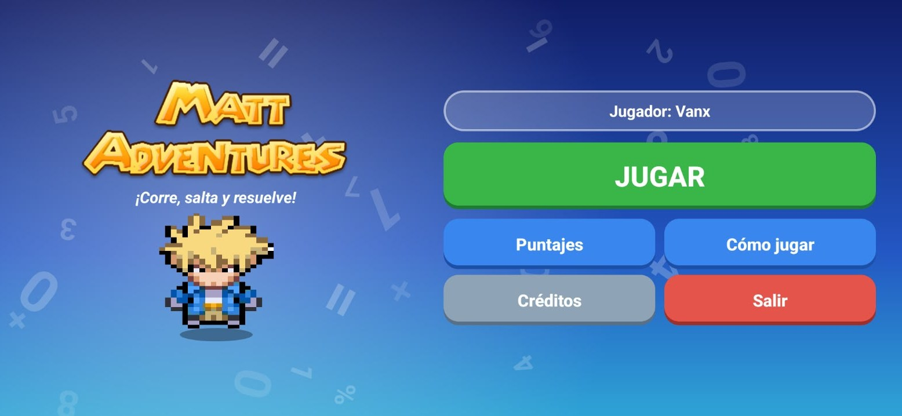
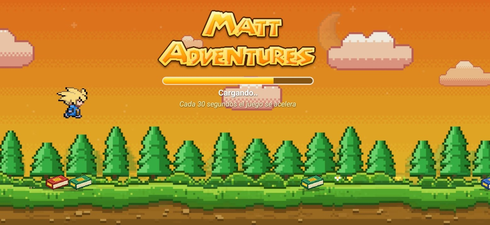

# Matt Adventures

Juego educativo de matemáticas para Android. Matt corre automáticamente por un escenario en pixel art y el
jugador toca la pantalla para saltar los libros que aparecen en el camino. Si choca con uno, el juego se detiene y
plantea una pregunta de matemáticas con tres opciones: acertar permite continuar y fallar cuesta un corazón.

Autor: [crisgp14](https://github.com/crisgp14)

## Capturas
| Menú principal | Splash (el juego en modo demostración) |
|---|---|
|  |  |

## Tecnologías
| Área | Uso |
|---|---|
| Lenguaje | Java 17 |
| Plataforma | Android (`minSdk 21`, `targetSdk` y `compileSdk 36`), solo orientación horizontal |
| Build | Gradle 8.13, Android Gradle Plugin 8.13.0 |
| Gráficos | `View` personalizada con `Canvas`, `BitmapShader` para las capas del escenario y animaciones de la API estándar |
| Audio | `MediaPlayer` (música) y `SoundPool` (efectos de sonido); toda la música y los efectos se sintetizan por código |
| Datos | SQLite (`SQLiteOpenHelper`) para las preguntas y los récords del jugador |
| Arte y audio | Pixel art y música generados con scripts de Python (Pillow, NumPy, SciPy, ffmpeg) |
| Pruebas | Simulaciones del motor y de las preguntas con Java puro (JDK, sin Android) |

El proyecto no tiene dependencias externas ni pide permisos.

## Sistema de juego
- **Control:** un solo botón de salto. El personaje corre de forma automática.
- **Obstáculos:** libros sueltos, pares y torres de 4 o 6 libros; generados al azar con separaciones siempre saltables.
- **Velocidad:** sube a los 30, 60 y 90 segundos (tres subidas como máximo). Con cada subida el escenario pasa de día
  a atardecer y a noche, y cambia la música.
- **Preguntas:** 30 preguntas de matemáticas que no se repiten hasta agotarlas. Cada una tiene tres opciones y una
  pista con la explicación del tema (cuesta puntos).
- **Vidas:** cuatro corazones. Al acertar hay 1.8 s de invulnerabilidad; al fallar se pierde un corazón; con cero termina
  la partida.
- **Puntos:** metros recorridos más 10 por cada libro esquivado; la pista cuesta 15.
- **Récords** (guardados en SQLite, visibles en "Puntajes"): mejor puntaje, mejor racha de libros esquivados y
  total de respuestas correctas.

## Arquitectura
Código en `app/src/main/java/cristiangiovannigonzalezplascencia/mattadventures/` (`namespace` del módulo). El identificador de la app instalada (`applicationId`) es `io.github.crisgp14.mattadventures`.

| Clase | Responsabilidad |
|---|---|
| `MotorJuego` | Lógica pura del juego: física, obstáculos, vidas y puntos. Trabaja en dp y segundos con un paso fijo de 1/120 s. No depende de Android. |
| `JuegoView` | Dibuja la partida, recibe el toque y tiene un modo demostración que usa el splash. |
| `Escenario` | Escenario de capas con parallax (cielo, estrellas, luna, nubes, árboles lejanos y cercanos, arbusto y piso) en versión día, atardecer y noche. |
| `Tablero` | Actividad de la partida: panel de preguntas, pausa, fin de juego, sonidos y guardado de récords. |
| `BolsaPreguntas`, `PreguntaJuego` | Reparto de preguntas sin repetir y armado de opciones. |
| `Bdpreguntas`, `BdUsuarios`, `EPreguntas` | Acceso a SQLite: preguntas y usuario con sus récords. |
| `MainActivity` | Splash: el propio juego en modo demostración mientras carga. |
| `Menu`, `CargarDatos`, `ComoJugar`, `Credito`, `FondoMenuView` | Menú principal, carga de datos, instrucciones y créditos. |
| `BaseActivity` | Pantalla completa, botón atrás (Android 16), medidas de pantalla y música. |

La dificultad se ajusta en la sección **AJUSTES** de `MotorJuego`: `VELOCIDADES`, `SEGUNDOS_POR_NIVEL`,
`VELOCIDAD_SALTO`, `GRAVEDAD`, `GAP_*`, `TIPOS`, `PESOS`, `VIDAS_INICIALES`, `SEGUNDOS_INVULNERABLE`,
`PUNTOS_POR_ESQUIVE` y `COSTO_PISTA`.

## Estructura del repositorio
```
app/                      módulo Android (código, recursos, manifiesto)
  src/main/java/...       clases del juego
  src/main/res/           layouts, drawables, sonidos (raw), iconos y valores
herramientas/             scripts de Python que generan el arte
  fuentes/                imagen base del logo
docs/capturas/            capturas de pantalla para el README
pruebas/                  pruebas de simulación (Java puro)
correr_pruebas.sh         compila y ejecuta las pruebas
```

## Compilar y ejecutar
1. Abrir la carpeta del proyecto con Android Studio (`File > Open`) y esperar el sync de Gradle.
2. Ejecutar en un dispositivo o emulador con **Run**, o generar el APK:
   ```
   ./gradlew assembleDebug        # Windows: gradlew.bat assembleDebug
   ```
   El APK queda en `app/build/outputs/apk/debug/`.

## Pruebas
```
sh correr_pruebas.sh
```
Requiere un JDK. Simula el motor del juego (subidas de velocidad, que cada obstáculo sea saltable en todas las
velocidades, huecos entre obstáculos y reglas de vidas), el reparto de preguntas y la demostración del splash.

## Arte
Todo el arte del escenario es pixel art (1 píxel de arte = 1 dp, dibujado sin suavizado) y se genera con scripts.
Requieren `pip install pillow numpy scipy`.

| Script | Genera |
|---|---|
| `herramientas/gen_pixel.py` | cielo, luna, nubes, árboles, arbustos, libros y corazones |
| `herramientas/gen_piso.py` | pasto y tierra (3 paletas) |
| `herramientas/gen_logo.py` | logo con letras rellenas, a partir de `herramientas/fuentes/ml_original.png` |
| `herramientas/gen_icono.py` | icono adaptativo (fondo, primer plano y monocromo) e iconos clásicos |

## Música
Composiciones originales en estilo chiptune, sintetizadas con `herramientas/gen_musica.py` (ondas cuadradas y triangulares,
ruido para la percusión; requiere `numpy`, `scipy` y `ffmpeg` con libvorbis). Cada pista dura 16 compases y se repite sin cortes.

| Pista | Dónde suena | Tonalidad / tempo |
|---|---|---|
| `musica_menu` | menú, créditos y cómo jugar | Do mayor, 88 bpm |
| `musica_dia` | partida, velocidad 1 | Do mayor, 126 bpm |
| `musica_atardecer` | partida, velocidad 2 | Sol mayor, 108 bpm |
| `musica_noche` | partida, velocidad 3 | Re menor, 140 bpm |
| `musica_fin` | fin de partida | La menor, 76 bpm |

## Licencia
El código se distribuye bajo la licencia [MIT](LICENSE).

## Créditos
Todo el código, el arte, la música y los efectos de sonido son originales de este proyecto.
